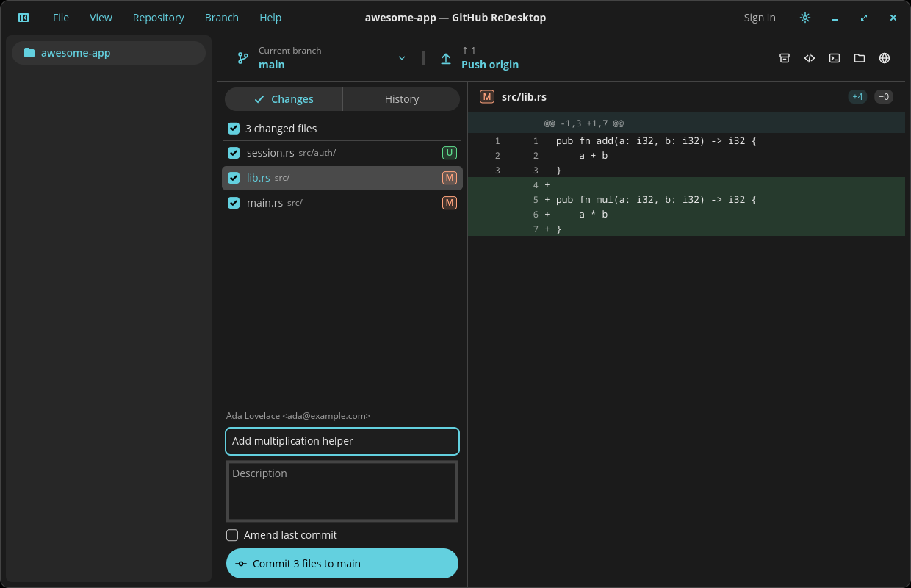
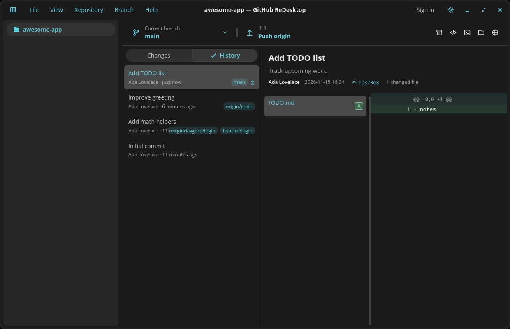
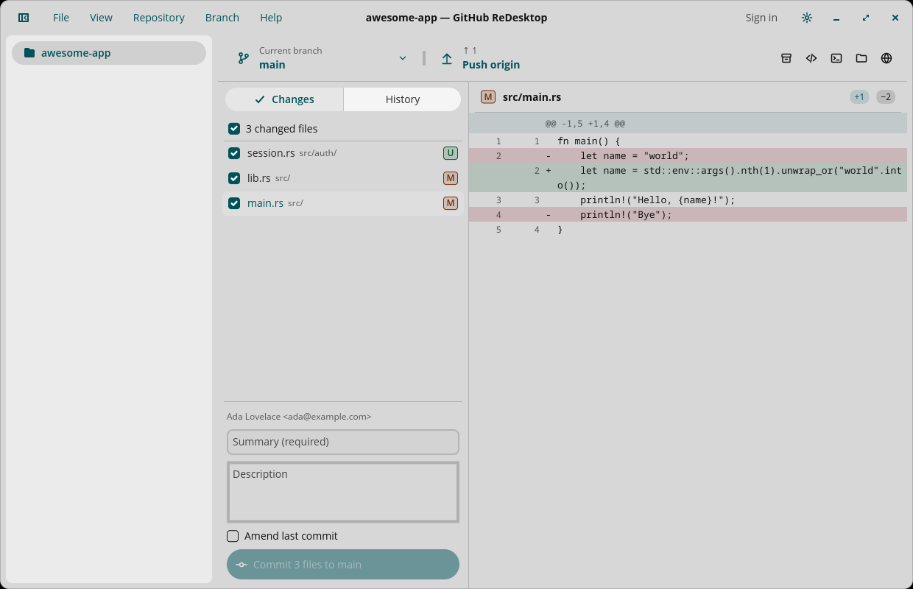

<div align="center">


# GitHub ReDesktop

**A fast, native GitHub Desktop for Linux, rewritten in Rust with [libcosmic](https://github.com/pop-os/libcosmic).**

[](https://github.com/Kisakay/GithubReDesktop/actions/workflows/ci.yml)
[](https://github.com/Kisakay/GithubReDesktop/releases)
[](LICENSE)




</div>

---

GitHub ReDesktop brings the workflow of [GitHub Desktop](https://github.com/desktop/desktop) to Linux
as a native application: no Electron, no web view, a single small binary that starts instantly and
follows your desktop theme. It is built with the COSMIC toolkit, so it looks right at home on
Pop!_OS/COSMIC and works on any Wayland or X11 desktop.

## ✨ Features

| | |
|---|---|
| **Changes** | Live list of changed files with status badges, per-file checkboxes to choose what goes into the commit, colored line-numbered diff, summary + description, amend last commit |
| **History** | Paginated commit list with refs and unpushed markers, commit details, changed files and their diff |
| **Branches** | Searchable branch picker, create / switch / rename / delete, check out remote branches, merge into the current branch, abort a merge, conflict banner |
| **Sync** | Smart *Fetch / Pull / Push / Publish* button with ahead/behind counters, background fetch every 5 minutes, force push with lease |
| **GitHub** | Sign in with a token or reuse your `gh` CLI login, clone from your repository list, publish a local repository to GitHub, open repo / commit / compare pages |
| **Commits** | Undo last commit, revert, cherry-pick, create a branch from a commit, copy SHA |
| **Files** | Discard changes (untracked files go to the trash), ignore a file or an extension, copy path, reveal in the file manager |
| **Stash** | Stash everything (including untracked files) and restore it in one click |
| **Integrations** | Open in your editor (VS Code, Zed, COSMIC Edit, …), terminal (COSMIC Terminal, Ghostty, Kitty, …) or file manager — auto-detected |
| **Desktop** | Dark / light / follow-the-system theme, English & French UI, keyboard shortcuts, single instance |

<table>
  <tr>
    <td></td>
    <td></td>
  </tr>
  <tr>
    <td align="center"><em>History</em></td>
    <td align="center"><em>Light theme</em></td>
  </tr>
</table>

## 📦 Installation

Grab the latest packages from the **[Releases page](https://github.com/Kisakay/GithubReDesktop/releases)**.
Every release ships `x86_64` and `aarch64` builds. `git` is the only runtime requirement.

### Debian / Ubuntu / Pop!_OS (`.deb`)

```sh
sudo apt install ./github-redesktop_*_amd64.deb     # or *_arm64.deb
```

### Fedora / RHEL / openSUSE (`.rpm`)

```sh
sudo dnf install ./github-redesktop-*.x86_64.rpm    # or *.aarch64.rpm
```

### Any distribution (`.tar.gz`)

```sh
tar xzf github-redesktop-*-linux-x86_64.tar.gz
cd github-redesktop-*-linux-x86_64
./install.sh            # installs into ~/.local
sudo ./install.sh /usr  # or system-wide
```

### NixOS / Nix ❄️

Try it without installing:

```sh
nix run github:Kisakay/GithubReDesktop
```

Add it to your NixOS configuration with the flake module:

```nix
# flake.nix
{
  inputs.github-redesktop.url = "github:Kisakay/GithubReDesktop";

  outputs = { nixpkgs, github-redesktop, ... }: {
    nixosConfigurations.my-host = nixpkgs.lib.nixosSystem {
      modules = [
        github-redesktop.nixosModules.default
        { programs.github-redesktop.enable = true; }
      ];
    };
  };
}
```

Also available: `overlays.default` (adds `pkgs.github-redesktop`), `homeManagerModules.default`
(`programs.github-redesktop.enable`) and `packages.<system>.default`.

## 🔐 Signing in to GitHub

Open **Settings** (gear icon) and either:

- click **Use GitHub CLI login** if you are already authenticated with [`gh`](https://cli.github.com/), or
- paste a [personal access token](https://github.com/settings/tokens/new?scopes=repo,read:org,workflow&description=GitHub%20ReDesktop)
  with the `repo`, `read:org` and `workflow` scopes.

The token is stored in your system keyring (Secret Service: GNOME Keyring, KWallet, …) and falls back
to a `0600` file in `~/.config/github-redesktop/` only when no keyring is available. It is handed to
`git` through a private `GIT_ASKPASS` helper for HTTPS remotes; SSH remotes keep using your SSH agent.

## ⌨️ Keyboard shortcuts

| Action | Shortcut | | Action | Shortcut |
|---|---|---|---|---|
| New repository | <kbd>Ctrl</kbd>+<kbd>N</kbd> | | Push | <kbd>Ctrl</kbd>+<kbd>P</kbd> |
| Add local repository | <kbd>Ctrl</kbd>+<kbd>O</kbd> | | Pull | <kbd>Ctrl</kbd>+<kbd>Shift</kbd>+<kbd>P</kbd> |
| Clone repository | <kbd>Ctrl</kbd>+<kbd>Shift</kbd>+<kbd>O</kbd> | | Fetch | <kbd>Ctrl</kbd>+<kbd>Shift</kbd>+<kbd>T</kbd> |
| Changes / History | <kbd>Ctrl</kbd>+<kbd>1</kbd> / <kbd>2</kbd> | | New branch | <kbd>Ctrl</kbd>+<kbd>Shift</kbd>+<kbd>N</kbd> |
| Open in editor | <kbd>Ctrl</kbd>+<kbd>Shift</kbd>+<kbd>A</kbd> | | Rename branch | <kbd>Ctrl</kbd>+<kbd>Shift</kbd>+<kbd>R</kbd> |
| Open in terminal | <kbd>Ctrl</kbd>+<kbd>\`</kbd> | | Merge into current | <kbd>Ctrl</kbd>+<kbd>Shift</kbd>+<kbd>M</kbd> |
| Show in file manager | <kbd>Ctrl</kbd>+<kbd>Shift</kbd>+<kbd>F</kbd> | | Stash changes | <kbd>Ctrl</kbd>+<kbd>Shift</kbd>+<kbd>S</kbd> |
| View on GitHub | <kbd>Ctrl</kbd>+<kbd>Shift</kbd>+<kbd>G</kbd> | | Compare on GitHub | <kbd>Ctrl</kbd>+<kbd>Shift</kbd>+<kbd>C</kbd> |
| Settings | <kbd>Ctrl</kbd>+<kbd>,</kbd> | | Refresh | <kbd>Ctrl</kbd>+<kbd>R</kbd> |

## 🛠️ Building from source

Requirements: Rust ≥ 1.90, `git`, `pkg-config`, and the development headers of
`libxkbcommon`, `wayland`, `fontconfig`, `freetype`, `expat` and `dbus`.

```sh
# Debian/Ubuntu
sudo apt install pkg-config libxkbcommon-dev libwayland-dev libfontconfig1-dev libfreetype-dev libexpat1-dev libdbus-1-dev
# Fedora
sudo dnf install pkgconf libxkbcommon-devel wayland-devel fontconfig-devel freetype-devel expat-devel dbus-devel

git clone https://github.com/Kisakay/GithubReDesktop && cd GithubReDesktop
cargo install just      # optional task runner
just run                # build & run in release mode
sudo just install       # install into /usr
```

With Nix, `nix develop` gives you a shell with every dependency, and `nix build` produces the package.

Useful recipes: `just test`, `just check` (clippy), `just fmt`, `just tarball`.

## 🧱 Architecture

```
src/
├── main.rs        entry point (also acts as the GIT_ASKPASS helper)
├── app.rs         application state, messages and update logic (Elm architecture)
├── config.rs      persistent settings (cosmic-config)
├── github.rs      GitHub REST API client + keyring token storage
├── tools.rs       editor / terminal / file-manager integration, time formatting
├── git/           git backend — shells out to `git`, like GitHub Desktop does
│   ├── status.rs  `git status --porcelain=v2` parser
│   ├── diff.rs    unified diff parser
│   ├── log.rs     history & commit files
│   ├── branch.rs  branches
│   └── tests.rs   end-to-end tests against a real temporary repository
└── ui/            views: toolbar, changes, history, diff, branches, dialogs, settings, welcome
```

Every repository operation runs the real `git` executable, so hooks, credential helpers, signing,
`includeIf` and the rest of your `.gitconfig` behave exactly like on the command line. Parsers are
unit-tested, and an end-to-end test drives a temporary repository through commit, branch, merge,
stash, discard, undo and revert.

## 🚀 Releasing

Bump `version` in `Cargo.toml` (and the `<releases>` entry in the metainfo), then push a tag:

```sh
git tag v0.2.0 && git push origin v0.2.0
```

The [release workflow](.github/workflows/release.yml) builds on native `x86_64` and `aarch64` runners
(Ubuntu 22.04 for broad glibc compatibility), produces the `.tar.gz`, `.deb` and `.rpm` packages and a
`SHA256SUMS` file, and publishes them in a GitHub release. The [CI workflow](.github/workflows/ci.yml)
runs rustfmt, clippy and the tests, and builds the Nix flake on both architectures.

## 🌍 Translations

Strings live in [`i18n/`](i18n) as [Fluent](https://projectfluent.org/) files. To add a language, copy
`i18n/en/github_redesktop.ftl` to `i18n/<lang>/` and translate it.

## 🙏 Credits

- Inspired by [GitHub Desktop](https://github.com/desktop/desktop) (MIT). This project is an
  independent reimplementation and shares no code with it.
- Built with [libcosmic](https://github.com/pop-os/libcosmic) and [iced](https://github.com/iced-rs/iced).

GitHub ReDesktop is not affiliated with or endorsed by GitHub, Inc. "GitHub" is a trademark of GitHub, Inc.

## 📄 License

[MIT](LICENSE) © Kisakay
